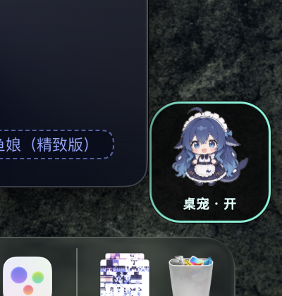

# dsh-pet-button

> 在桌面上放一张**桌宠开关**小卡片：点一下开/关桌宠；Harness 没关的时候它还能顺手把 Harness 拉起来。



## 前置插件

本插件控制的是 **[dsh-pet](https://github.com/PC2005-cloud/dsh-pet)** 这只桌宠，**必须先装它**，否则卡片点下去没有可切换的对象：

```sh
dsh plugin --profile web add dsh-pet
```

- GitHub：<https://github.com/PC2005-cloud/dsh-pet>
- npm：<https://www.npmjs.com/package/dsh-pet>

那只蓝毛小女仆的 106 个动画、碎碎念、余额气泡，全部来自 dsh-pet，本项目只是给它加了一个桌面上的开关。

## 它是什么

DSH 插件跑在 Harness 进程里，画不了桌面上的透明窗口。所以这里分成两半：

```
dsh-pet-button（插件）
├─ 宿主半侧 lib/index.js      ← 管小部件的启停、提供本地接口
└─ assets/桌宠开关.app         ← 真正浮在桌面上的那张卡（macOS 原生 Swift 小应用）
```

插件负责"什么时候让它活着"，小部件负责"长什么样、点下去做什么"。

## 安装

```sh
dsh plugin --profile web add github:kongbaiming5/dsh-pet-button
```

首次启用时，插件会把 `assets/桌宠开关.app` 自动装到 `~/Applications`，不需要手动拷贝。

## 开关语义

| 操作 | 结果 |
|---|---|
| 插件市场里把 `dsh-pet-button` 打开 | 拉起小部件 |
| 把它关掉 | 关掉小部件（app 留着，下次还能开） |
| 退出 Harness | **小部件保留**，还能继续用它启动 Harness |
| 从插件市场卸载 | 杀掉进程，**并删除** `~/Applications/桌宠开关.app`、偏好、日志、LaunchAgent |

判别依据：卸载会把包从 profile 的 `dependencies` 里删掉；关闭只会删 `bundles`；退出 Harness 两者都不动。所以**卸载后本机不会留下任何东西**。

## 小部件本身

- **左键**：开 / 关桌宠
- **按住拖动**：挪位置，位置会记住
- **右键**：贴在桌面（小部件层）/ 始终置顶 / 回到右下角 / 退出
- **Harness 没开时**显示「启动」，点一下会拉起 Harness（走 `launchctl`，绕过单实例锁）

## 平台

小部件是编译好的 **macOS arm64** 二进制。其他平台装插件不会报错，只是不会弹出小部件。

## 本地接口

宿主注册在 `/dsh-pet-button/*`：

```
GET  /status   → { running, enabled, app }
POST /launch   → 显示小部件
POST /quit     → 隐藏小部件
```

## 致谢

- **[dsh-pet](https://github.com/PC2005-cloud/dsh-pet)** —— 桌宠本体、角色形象、动画素材与全部"性格"都来自这个项目，没有它这张卡片无从谈起。
- **DeepSeek（DeepSeek Harness）** —— 本项目从需求拆解、DOM/样式考古、Swift 小部件、插件协议对接到发布文档，由 **DeepSeek** 端到端完成。其中几个关键结论也是它跑出来的：`dsh-app://` 页面的请求链路、`launchctl submit` 的 KeepAlive 陷阱、以及区分"卸载 / 关闭 / 退出 Harness"三种插件生命周期状态的办法。可以说，这个插件的**重大贡献来自 DeepSeek**。

## License

MIT
